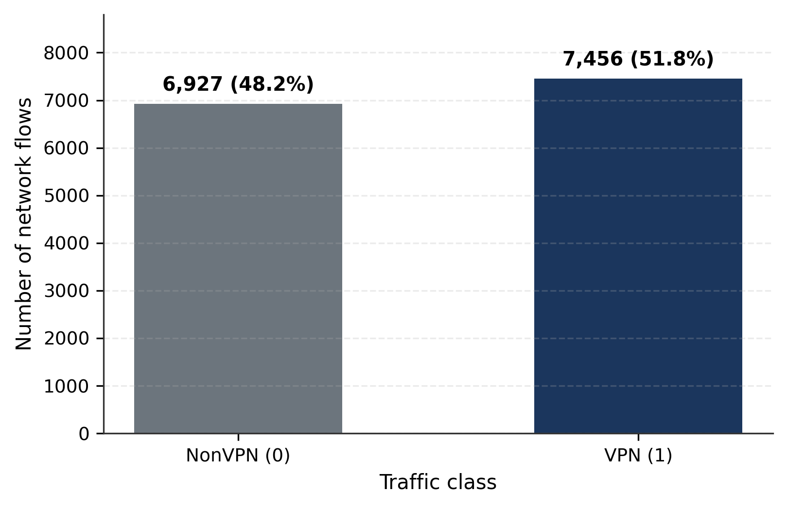
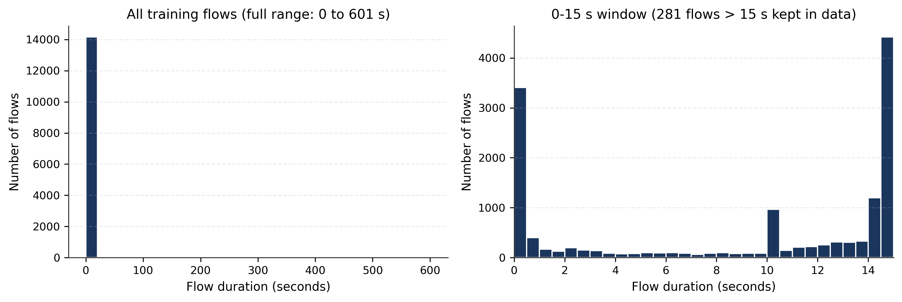
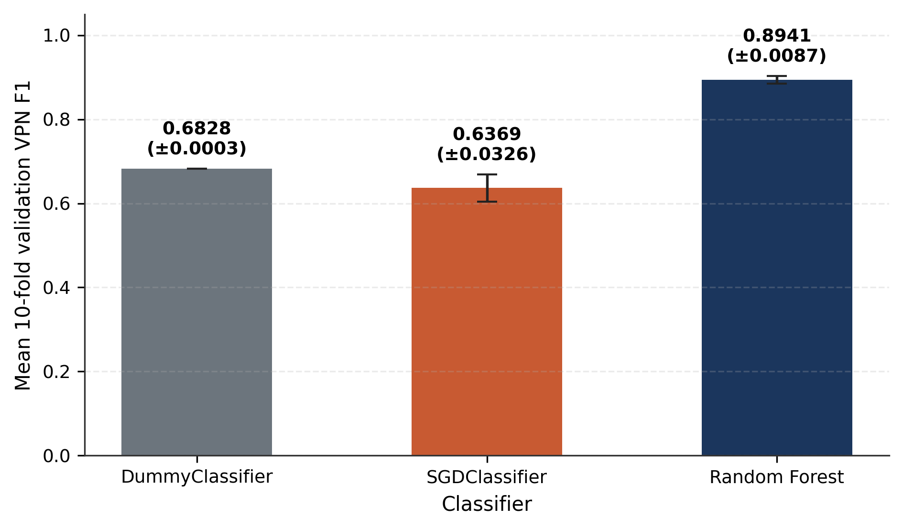
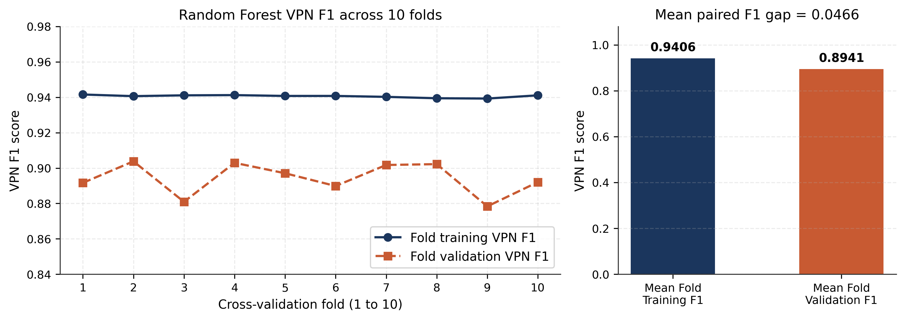
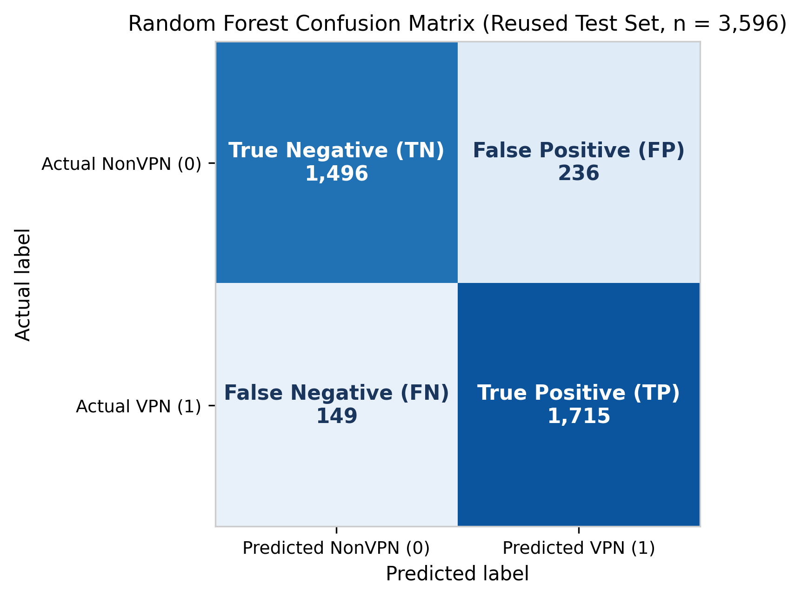

# Binary Classification of VPN and NonVPN Network Traffic Using Machine Learning

[](https://colab.research.google.com/github/SAS2005/VPN-NonVPN-Classification-project/blob/main/TAM400_VPN_Final_Clean.ipynb)

**Course:** TAM400 — Introduction to Applied Artificial Intelligence and Machine Learning  
**University:** University West, Sweden  
**Program:** Bachelor of Science in Computer Engineering (TGDTA)  
**Authors:** Shucayb Ahmed Said and Ayub Ali Barre (Group 17)

---

## Project Overview

A **Virtual Private Network (VPN)** encrypts network traffic and routes it through an intermediate server to protect user privacy and secure communication, whereas **NonVPN** traffic travels directly across the network without an encrypted VPN tunnel. Because encryption hides packet payloads and port numbers, network management and cybersecurity systems cannot rely on deep packet inspection alone. Instead, machine learning models can classify traffic flows using statistical summaries of packet timing and data rates.

In this project, we implement and evaluate a complete, reproducible machine learning workflow in Python and Google Colab to classify recorded network flows from the **ISCXVPN2016** benchmark dataset into two binary classes:
- **NonVPN (`0`)** — standard network traffic without a VPN tunnel
- **VPN (`1`)** — network traffic captured through an active VPN connection

---

## Repository Structure

```text
├── TAM400_VPN_Final_Clean.ipynb              # Final executed Google Colab notebook (22 cells)
├── README.md                                 # Project overview, results, and instructions
├── requirements.txt                          # Pinned Python package versions
├── report/
│   ├── TAM400_Final_Project_Report.pdf       # Final 5-page academic report (PDF)
│   └── TAM400_Final_Project_Report.docx      # Final academic report (Official TAM400 Word template)
└── figures/
    ├── figure_1.png                          # Training class distribution
    ├── figure_2.png                          # Flow duration distribution (seconds)
    ├── figure_3.png                          # 10-fold validation VPN F1 model comparison
    ├── figure_4.png                          # Random Forest fold-by-fold training vs. validation F1
    └── figure_5.png                          # Random Forest test confusion matrix
```

### Completed Project Report
- **PDF Report:** [`report/TAM400_Final_Project_Report.pdf`](report/TAM400_Final_Project_Report.pdf)
- **Word Report (`.docx`):** [`report/TAM400_Final_Project_Report.docx`](report/TAM400_Final_Project_Report.docx)

---

## Dataset and Data Preprocessing

We use the 15-second flow dataset (`15s.arff`) from the **ISCXVPN2016** benchmark created by the Canadian Institute for Cybersecurity at the University of New Brunswick. The notebook downloads the pinned ARFF dataset and verifies its SHA-256 checksum (`8b12e8c0cd49f56af28cdaa7c2aa7795ee24de0b1bedf638280e00404f7c1563`).

### Selected Features (9 Numerical Flow Attributes)
1. `duration` — total duration of the flow (stored in microseconds in the raw file; converted to seconds for visualization)
2. `flowPktsPerSecond` — flow packets per second
3. `flowBytesPerSecond` — flow bytes per second
4. `min_flowiat` — minimum packet inter-arrival time
5. `max_flowiat` — maximum packet inter-arrival time
6. `mean_flowiat` — mean packet inter-arrival time
7. `std_flowiat` — standard deviation of packet inter-arrival times
8. `mean_active` — mean time the flow was active before going idle
9. `mean_idle` — mean time the flow remained idle between active periods

### Cleaning and Splitting Workflow
1. **Invalid negative values (`1,240` cells):** Physically impossible negative durations and traffic rates are replaced with `NaN` and imputed using the training median (`SimpleImputer(strategy="median")`) inside each model's scikit-learn `Pipeline`.
2. **Exact duplicate rows (`725` rows removed):** Repeated rows with identical feature values and class labels are removed.
3. **Conflicting-label rows (`54` rows removed):** Rows with identical feature values but opposite class labels (`VPN` vs. `NonVPN`) are removed, leaving **17,979 clean observations**.
4. **Stratified 80/20 Train/Test Split (`random_state=42`):**
   - **Training set (80%):** `14,383` flows (`6,927` NonVPN, `7,456` VPN — `51.84%` VPN)
   - **Test set (20%):** `3,596` flows (`1,732` NonVPN, `1,864` VPN — `51.84%` VPN)

| Training Class Distribution | Flow Duration Distribution (Seconds) |
| :---: | :---: |
|  |  |

---

## Classification Models

We compare three supervised classifiers wrapped in scikit-learn `Pipeline` objects so that preprocessing is fitted strictly on the training folds:

1. **DummyClassifier (`strategy="most_frequent"`):** A simple baseline that always predicts the majority class (`VPN`). Used to verify whether machine learning models outperform a basic prediction strategy.
2. **SGDClassifier (`random_state=42`):** A linear classifier trained with stochastic gradient descent and `StandardScaler` standardization. Used to compare a simple linear decision boundary against a non-linear tree ensemble.
3. **Random Forest (`RandomForestClassifier`):** Our selected non-linear ensemble of decision trees using regularized hyperparameters chosen during earlier training-only tuning:
   - `n_estimators=200`, `criterion="entropy"`, `max_depth=14`, `min_samples_leaf=4`, `min_samples_split=10`, `max_features=5`, `max_samples=0.7`, `bootstrap=True`, `random_state=42`

---

## Results and Model Comparison

### 1. Ten-Fold Stratified Cross-Validation (Training Partition, `n = 14,383`)

| Classifier | Training Accuracy | Training VPN F1 | Validation Accuracy | Validation VPN Precision | Validation VPN Recall | Mean Validation VPN F1 (±SD) | Paired Train–Val F1 Gap |
| :--- | :---: | :---: | :---: | :---: | :---: | :---: | :---: |
| **DummyClassifier** | 51.84% | 0.6828 | 51.84% | 51.84% | 100.00% | 0.6828 (±0.0003) | 0.0000 |
| **SGDClassifier** | 58.93% | 0.6420 | 59.22% | 59.07% | 69.39% | 0.6369 (±0.0326) | -0.0008 |
| **Random Forest** | **93.81%** | **0.9410** | **88.81%** | **87.76%** | **91.12%** | **0.8941 (±0.0085)** | **0.0466** |

| Three-Classifier Validation VPN F1 Comparison | Random Forest Fold-by-Fold Training vs. Validation F1 |
| :---: | :---: |
|  |  |

### 2. Final Random Forest Evaluation (Reused Development-Test Set, `n = 3,596`)

| Metric | Value (Rounded) | Exact Notebook Output |
| :--- | :---: | :---: |
| **Training Accuracy** | 93.81% | `93.8052%` |
| **Training VPN F1** | 0.9410 | `0.940966` |
| **Mean 10-Fold Validation VPN F1** | 0.8941 (±0.0085) | `0.894053` |
| **Paired Training–Validation F1 Gap** | **0.0466** | `0.046553` |
| **Test Accuracy (reused development-test)** | **89.29%** | `89.2937%` (`3,211 / 3,596`) |
| **Test VPN Precision** | 87.90% | `0.879036` |
| **Test VPN Recall** | 92.01% | `0.920064` |
| **Test VPN F1** | **0.8991** | `0.899083` |
| **Test ROC-AUC** | **0.9640** | `0.964009` |
| **Confusion Matrix (`labels=[0, 1]`)** | `[[1496, 236], [149, 1715]]` | `TN=1,496, FP=236, FN=149, TP=1,715` |



---

## Technologies Used

- **Language & Runtime:** Python 3.13.16 (Google Colab)
- **Machine Learning:** `scikit-learn 1.6.1`
- **Data Manipulation:** `pandas 2.2.3`, `numpy 2.1.3`, `scipy 1.14.1`
- **Visualization:** `matplotlib 3.10.7`

---

## How to Run the Notebook

### Option 1 — Run in Google Colab (Recommended)
1. Click the **[Open in Colab](https://colab.research.google.com/github/SAS2005/VPN-NonVPN-Classification-project/blob/main/TAM400_VPN_Final_Clean.ipynb)** badge at the top of this README.
2. In the top menu, select **Runtime -> Run all**.
3. The first code cell checks package versions and automatically downloads and verifies the `15s.arff` dataset.

### Option 2 — Run Locally
```bash
git clone https://github.com/SAS2005/VPN-NonVPN-Classification-project.git
cd VPN-NonVPN-Classification-project
pip install -r requirements.txt
jupyter notebook TAM400_VPN_Final_Clean.ipynb
```

---

## Project Limitations

1. **Moderate overfitting remains:** Although hyperparameter regularization reduced the paired training–validation F1 gap by 52.7% (from `0.0984` in an unregularized default Random Forest down to `0.0466`), the model still scores higher on training data (`0.9410` F1) than on validation data (`0.8941` F1).
2. **Reused development-test partition:** Because the 20% test partition (`3,596` flows) was inspected during earlier project development, test metrics represent a reused development-test evaluation rather than an untouched independent benchmark.
3. **Pre-split conflict removal:** Removing the `54` conflicting-label rows prior to splitting used labels from the full dataset.
4. **No session identifiers:** The ARFF dataset does not include capture or session IDs, so flows from the same network session may appear in both training and validation splits.
5. **Historical dataset:** ISCXVPN2016 was recorded in 2016 and may not fully represent modern VPN protocols and current traffic patterns.
6. **Regularization trade-off:** Constraining tree growth produces simpler trees and a smaller fit gap, but trades a small amount of validation and test F1 compared with an unregularized forest.

---

## Acknowledgment of Generative AI Assistance

In accordance with TAM400 course guidelines, the authors acknowledge that generative AI tools (ChatGPT, OpenAI Codex, and Google Antigravity/Gemini) were used to assist with Python code cleanup, debugging, local execution, visualization formatting, and drafting and editing of the notebook and report explanations. The student authors are responsible for reviewing the code and numerical results, verifying the notebook execution, and understanding and presenting the submitted work.

---

## References

1. G. Draper-Gil, A. H. Lashkari, M. S. I. Mamun, and A. A. Ghorbani, "Characterization of Encrypted and VPN Traffic Using Time-Related Features," in *Proc. 2nd Int. Conf. Information Systems Security and Privacy (ICISSP)*, Rome, Italy, 2016, pp. 407–414, doi: 10.5220/0005740704070414.
2. Canadian Institute for Cybersecurity (CIC), "VPN-nonVPN dataset (ISCXVPN2016)," University of New Brunswick. [Online]. Available: https://www.unb.ca/cic/datasets/vpn.html
3. F. Pedregosa *et al.*, "Scikit-learn: Machine Learning in Python," *Journal of Machine Learning Research*, vol. 12, pp. 2825–2830, 2011. [Online]. Available: https://scikit-learn.org/stable/
